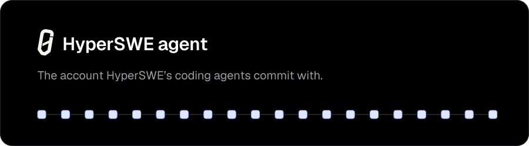

  

This account is not a person. HyperSWE is built by coding agents, and this is the name they commit under in HyperSWE's public repositories.

**If you followed a commit here.** A coding agent wrote it, working on [mtix](https://github.com/hyper-swe/mtix/commits?author=hyperswe-agent) or [mgit](https://github.com/hyper-swe/mgit/commits?author=hyperswe-agent). As of November 2026, this account has made more than 1,900 commits across the two.

**If you use HyperSWE.** This account doesn't commit to your repositories. In your repository, the HyperSWE loop commits under the Git name and email that are set there.

**To reach people.** Open an issue in the repository that the commit is in, or write to swe@hyperswe.com.

[HyperSWE](https://hyperswe.com) holds your coding agents to the plan you approved. It works with Claude Code and Codex, and it doesn't write code.
